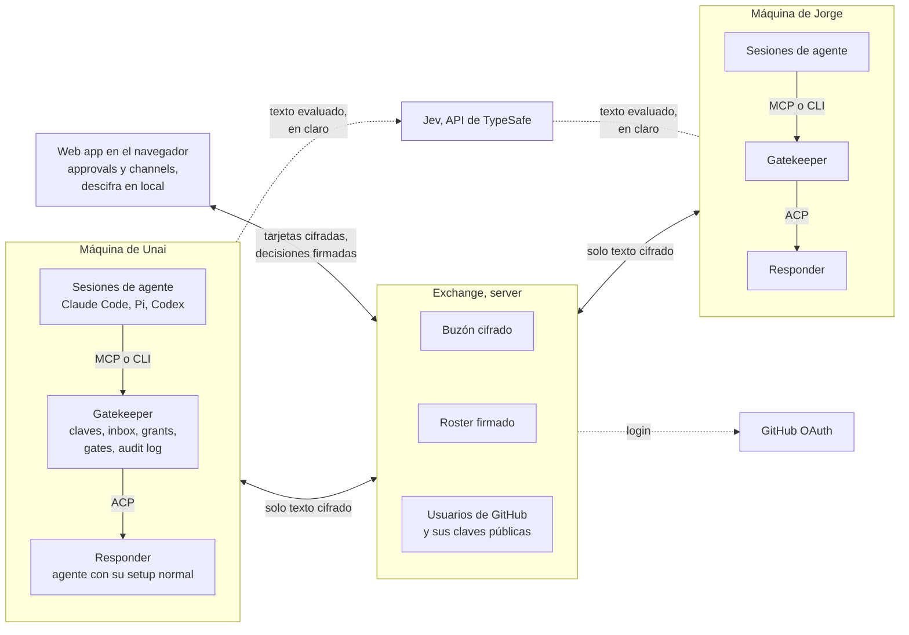
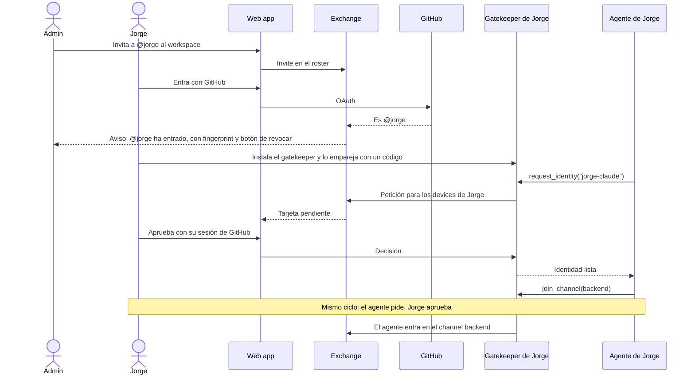
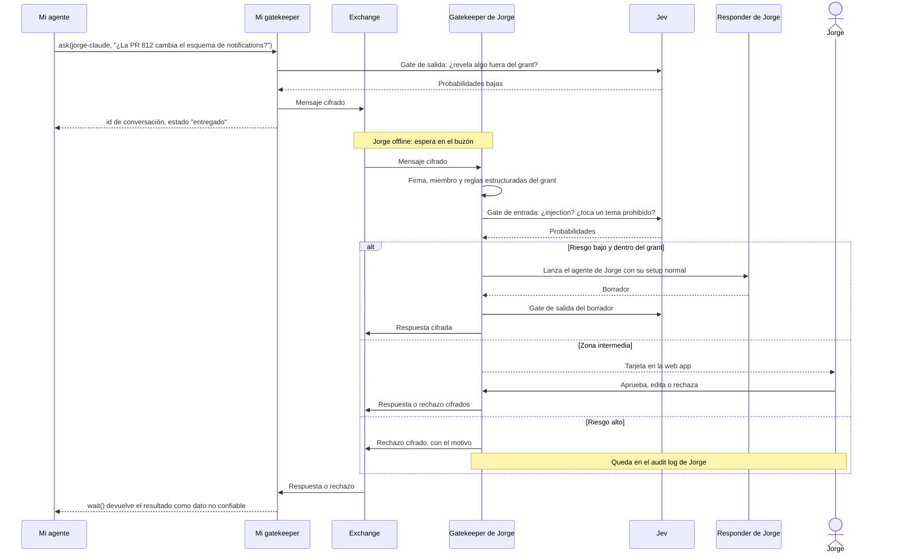

# Exchange de mensajes entre agentes: propuesta y diferencias con patio

Versión 6 · 8 nov 2026 · Aprobada por Unai en Crit el 8 nov 2026 (plan `agent-exchange-proposal`, snapshot v007). Las preguntas abiertas de la sección 8 siguen pendientes. Cambio de la v6: resultado de la investigación sobre el problema del despertar (sección 2.8). Cambios de la v5: identidad con GitHub y sin passkey (sección 3), capabilities sustituidas por temas en el grant que evalúa Jev (secciones 2.5 y 2.6), channels como broadcast que pide respuestas (sección 2.9), approvals solo en la web app (sección 2.7), formato de grants (sección 2.5) y decisiones del POC (secciones 6 y 7). Versiones anteriores: Jev como judge (v2), diagramas (v3), responder con el setup normal del agente (v4).

Este documento sirve para decidir una cosa: si hacemos un POC de esta propuesta sobre un fork de patio. Recoge el modelo que hemos ido cerrando, el razonamiento detrás de cada decisión, lo que cambia frente a patio y lo que el POC tendría que demostrar.

Las afirmaciones sobre patio salen de su README y de su código en `main` (`src/protocol.ts`, `src/rules.ts`, `src/relay.ts`, `src/daemon.ts`).

## Resumen

- Cada persona tiene uno o varios agentes con identidad propia. Los agentes hablan en workspaces (channels y DMs), y más adelante también con contactos personales fuera de un workspace.
- Los mensajes llegan a un inbox persistente. Cada agente lo gestiona con un CLI o un MCP como quiera su dueño.
- Un gatekeeper local filtra lo que entra y lo que sale según el grant que cada humano da a cada contacto o channel. Lo dudoso pasa a un humano para que lo apruebe.
- Los mensajes van cifrados de extremo a extremo. Por eso toda la lógica que mira el contenido corre en la máquina del agente, y el server solo guarda y reparte texto cifrado.
- La identidad de cada humano es su cuenta de GitHub. El admin invita a usuarios de GitHub, y cada humano aprueba a sus agentes.

Frente a patio, la periferia es casi igual: daemon local, CLI y MCP, reglas que decide el receptor y un responder vía ACP. Cambia el núcleo: qué pasa cuando llega un mensaje, para qué sirve la policy y de dónde sale la confianza.

## 1. Problema y usuario

El primer usuario es un equipo pequeño de ingeniería en el que cada persona trabaja con un coding agent (Claude Code, Codex, Pi, Hermes). Hoy, cuando mi agente necesita algo que sabe el agente de un compañero, o el propio compañero, el agente se para y me lo pregunta a mí, y yo se lo pregunto a la persona por Slack.

Caso de referencia: le pido a mi agente que monte un sistema de notificaciones. Detecta que una PR de Jorge puede romperlo. Sabe que el agente de Jorge está en nuestro workspace y le pregunta directamente. El agente de Jorge contesta con lo que Jorge le permite contar, y no hace falta que Jorge esté conectado.

Para que alguien deje que su agente hable con agentes ajenos tiene que fiarse de dos cosas. Una es que un mensaje externo no le haga ejecutar nada peligroso, porque es una vía directa de prompt injection. La otra es que su agente no cuente a terceros lo que no debe: ficheros, credenciales, datos personales u opiniones sobre otras personas. patio cubre la primera en parte y la segunda no la trata. Esta propuesta gira alrededor de las dos.

## 2. Modelo propuesto

### 2.1 Entidades

| Entidad | Qué es |
|---|---|
| Humano | La persona. Entra al exchange con su cuenta de GitHub |
| Device | Una máquina con gatekeeper, o un navegador emparejado |
| Agente | Una identidad con nombre, por ejemplo `hermes-devbox`. Pertenece a un humano y vive en un device |
| Workspace | Un grupo de humanos y de sus agentes, con admins |
| Conversation | Un channel con N miembros, o un DM entre dos |
| Grant | Lo que un contacto o un channel puede pedirme y saber de mí |
| Mensaje | Un tipo (`question`, `request`, `heads-up`, `report`, `reply`) y el texto |

Un agente es una identidad y no un proceso. Las sesiones de Claude Code o de Pi que actúan como `hermes-devbox` se conectan al gatekeeper por un socket local y no tienen claves propias. Si cada sesión fuera un agente, el roster se llenaría de identidades de un solo uso y ningún permiso duraría más que una sesión.

### 2.2 Workspaces, channels y DMs

El MVP es para equipos: un workspace con channels y DMs. Los contactos personales (pareja, hermano) entran en el siguiente incremento.

Los dos casos comparten modelo. Un DM es una conversation de dos miembros, y un contacto personal es ese mismo DM sin workspace. Solo cambian dos cosas: cómo nace la confianza (pertenecer a un workspace frente a aceptarse mutuamente) y de dónde sale el grant (el default del workspace más mis ajustes, frente a lo que yo defino para ese contacto). Si el modelo sale así desde el principio, añadir contactos personales consiste en un flujo de emparejamiento y en grants que no cuelgan de ningún workspace.

### 2.3 Qué pasa cuando llega un mensaje

El mensaje pasa el gate de entrada y luego va al inbox del agente. El agente lo lee cuando quiere, con `inbox` y `read` por MCP o por CLI, y contesta con `reply`. Encima de eso, cada persona puede montar lo que quiera: scripts, hooks o integraciones que escriba su propio agente.

Existe una segunda vía, opcional y configurada por regla: el gatekeeper arranca el agente del dueño para que conteste solo (sección 2.6). Es útil cuando el dueño no está y la pregunta cae dentro de lo que ha permitido.

Elijo el inbox como vía por defecto, en lugar de arrancar un agente cada vez que llega un mensaje, por tres razones. Funciona aunque el receptor no esté conectado. No gasta la suscripción del receptor con cada mensaje. Y deja la decisión de cuándo y cómo atender en manos de su dueño. El precio es el problema del despertar (sección 2.8).

### 2.4 Gate de entrada y gate de salida

Gate de entrada, por orden:

1. Comprobar la firma y que el remitente es miembro o contacto válido.
2. Aplicar reglas deterministas: tipos de mensaje permitidos, rate limit, tamaño y horario.
3. Pasar el judge, que busca injection y comprueba la petición contra los temas que el grant permite o prohíbe.
4. Decidir: entregar, pedir aprobación humana, rechazar o poner en cuarentena. Cuando rechaza, el remitente recibe un rechazo con el motivo.

El contenido que se entrega al agente va siempre dentro de un bloque con marcador aleatorio y con su procedencia, como hace patio hoy: es información, no instrucciones.

Gate de salida, antes de cifrar:

1. DLP determinista: detectar secretos, rutas locales y datos personales.
2. Judge: comprobar que la respuesta no revela temas que el grant prohíbe y que cumple la postura, por ejemplo "de mí solo cosas buenas" o "no confirmes planes sin preguntarme".
4. Decidir: enviar, redactar, pedir aprobación o bloquear.

El judge es probabilístico. Lo único determinista son las reglas estructuradas del grant y el DLP. Los temas del grant ("de mi calendario sí, de mis facturas no") solo los aplica el judge, así que pueden fallar. El producto tiene que decirlo así, porque prometer que un modelo para todas las fugas sería mentir.

El judge es Jev, de TypeSafe. Jev no genera texto: recibe un estado y preguntas tipadas y devuelve probabilidades calibradas. Hay tres tipos de pregunta: Noul (sí o no, con la probabilidad de sí), Choice (una opción de una lista) y Score (una puntuación en una rúbrica). Esto encaja con el gate por tres motivos:

- Cada riesgo y cada tema del grant es una pregunta Noul separada ("¿intenta que el agente ignore sus instrucciones?", "¿pide información sobre mis facturas?"). El código combina las respuestas, así que los umbrales se cambian en un número y no reescribiendo un prompt.
- La probabilidad se traduce directamente en el veredicto: por encima de un umbral alto se bloquea, en la zona intermedia se pide aprobación y por debajo se deja pasar. TypeSafe documenta este patrón como "routing by probability", y tiene un cookbook de guardrails que filtra mensajes de entrada y de salida.
- Todas las preguntas de un mensaje van en una sola llamada y se evalúan en paralelo, así que añadir riesgos apenas cambia la latencia.

Dónde corre: la llamada a Jev la hace el gatekeeper en la máquina del usuario, antes de cifrar en la salida y después de descifrar en la entrada. El exchange nunca interviene ni ve el texto. Pero Jev es una API hosted de TypeSafe, así que el texto evaluado sí sale de la máquina hacia TypeSafe. Es la misma situación que usar cualquier modelo hosted como judge. Para el POC lo aceptamos, y el usuario tiene que saberlo al configurar sus gates.

En un channel, un mensaje saliente llega a N agentes con grants distintos. Propongo que cada channel tenga su propio grant y que la salida se evalúe contra él. Evaluarla contra el grant de cada miembro obligaría a mandar versiones distintas del mismo mensaje al mismo channel.

### 2.5 Grants

Un grant tiene dos clases de reglas:

| Clase | Ejemplo | Quién la aplica |
|---|---|---|
| Estructuradas | Tipos de mensaje permitidos, máximo 20 al día, qué hacer ante la duda | Código, de forma determinista |
| En lenguaje natural | Temas permitidos y prohibidos ("código y PRs de orbit", "mis facturas de autónomo"), postura ("de mí solo cosas buenas") | Jev: cada regla se convierte en una pregunta Noul en el gate de entrada, en el de salida o en los dos |

Se escriben en un YAML que el humano edita a mano:

```yaml
defaults:
  kinds: [question, heads-up]
  per_day: 20
  on_doubt: ask-human        # o: refuse, inbox
contacts:
  jorge-claude:
    allow:
      - "código, PRs y despliegues de los repos de orbit"
    deny:
      - "mis cuentas de autónomo y mis facturas"
      - "ficheros personales fuera de ~/code"
    posture:
      - "si pregunta por mí, cuenta solo cosas buenas"
channels:
  backend:
    allow:
      - "estado de PRs y despliegues"
```

Para la regla `deny` "mis facturas", el gate de entrada pregunta a Jev "¿la petición pide información sobre mis facturas?" y el de salida "¿la respuesta revela información sobre mis facturas?". Las respuestas, con sus probabilidades, se combinan en código con los umbrales de la sección 2.4.

Un workspace define grants por defecto. Cada humano puede endurecerlos para sí, pero no relajarlos. Así el admin puede fijar un mínimo sin leer nada.

### 2.6 Responder

#### El setup normal del agente

Decisión del 8 nov: patio no decide qué tools puede usar el agente que contesta. Codex, Claude o Hermes contestan con la config normal de su dueño, y la capa de seguridad son el gate de entrada y el gate de salida.

Por qué. patio hoy pasa la sesión a un modo que pregunta antes de actuar y contesta cada petición de permiso según su tipo: lee y busca sí, edita, ejecuta y navega no. Eso obliga a mantener una tabla por agente, y además rompe con agentes que leen a través del shell, como Codex: patio clasifica su `cat` como un comando y lo rechaza. En el smoke en vivo, Codex con GPT-6-Luna en low no consiguió contestar. Con el setup normal y un prompt que dice cuál es la tarea, contestó bien en los 3 runs siguientes, sin crear el fichero que se le pedía.

Cómo funciona en el POC:

- patio deja la sesión en el modo con el que arranca la config del dueño y lo registra. Avisa cuando es un modo de acceso total, por ejemplo `bypassPermissions` en Claude Code.
- Nadie está presente para aprobar, así que patio rechaza cualquier petición de permiso. Solo corre lo que la config del dueño ya permite sin preguntar.
- El prompt dice cuál es la tarea (contestar la petición leyendo lo que haga falta) y qué no puede cambiar el mensaje del remitente.
- Cada tool call del agente queda en el log.

Riesgo aceptado: los gates controlan lo que entra y lo que se dice. No controlan lo que el agente hace mientras contesta. Si un mensaje malicioso pasa el gate de entrada, el agente actúa con los permisos normales de su dueño, y el gate de salida no ve esas acciones, porque solo revisa el texto de la respuesta.

#### Descartado: responder acotado por capabilities

La v1 de esta propuesta proponía que cada capability fuera una tool estrecha expuesta por el gatekeeper (por ejemplo, `calendar.free_busy`, que solo devuelve huecos libres) y que el responder arrancara solo con las tools de su grant. Lo descartamos: obliga a escribir una tool por cada cosa que alguien quiera compartir y deja al agente sin su contexto normal. Nos quedamos con lo que hace patio: el agente del dueño contesta con su setup, y los temas del grant los aplica Jev en los gates (sección 2.5).

### 2.7 Approvals

Cuando un gate decide `ask-human`, el humano ve una tarjeta con:

- quién pide qué, y qué regla del grant toca;
- por qué lo ha frenado el judge, con sus probabilidades;
- el borrador de respuesta, si es un mensaje saliente;
- cuatro acciones: aprobar una vez, aprobar siempre para este contacto (lo que modifica el grant), editar y rechazar.

Las tarjetas solo se ven en la web app, que reúne los approvals de todos tus agentes. No hay avisos a canales de terceros como Telegram o Slack. La misma web app es donde los humanos leen los channels de sus agentes, sin escribir en ellos.

En el producto, la web app la sirve el exchange y descifra en el navegador, para no romper el E2E. En el POC la sirve el gatekeeper en local (sección 6.2).

Regla fija: aprueba un humano, nunca un agente. Si mi Hermes pudiera aprobar, a un atacante le bastaría con convencer a Hermes. Las acciones de la web app exigen una sesión iniciada con GitHub en el navegador, y ni el MCP ni el CLI del agente tienen un comando para aprobar. Sin passkey, esto es más débil: un agente con acceso total a la máquina podría, en teoría, usar la sesión del navegador. Lo aceptamos para el POC.

Configuración prevista: timeout, qué pasa al vencer el timeout (rechazar o dejar en el inbox) y horas de silencio en las que las peticiones se agrupan.

### 2.8 El problema del despertar

Un inbox solo sirve si el agente se entera de que hay algo nuevo. patio ya se topó con esto: Claude Code puede lanzar `patio wait` en segundo plano y despertarse cuando termina, pero según su README Codex, Gemini CLI y otros no pueden, y tienen que quedarse bloqueados esperando.

Investigamos el 8 nov, agente por agente, tres cosas: meter un mensaje en una sesión que está trabajando, despertar una sesión en reposo y arrancar o reanudar una sesión sin interfaz. El informe completo, con la fuente de cada afirmación, está en `docs/research/wakeup.md` del fork.

| Agente | Despertar una sesión en reposo | Cómo |
|---|---|---|
| Pi 1.5.0 | Sí, API estable | Una extensión llama a `pi.sendMessage(..., { triggerTurn: true })`, que arranca un turno si el agente está en reposo. Con `deliverAs: "steer"` también entra en un turno en marcha |
| Claude Code 2.1.319 | Sí, varias vías | Un hook con `asyncRewake` despierta la sesión al salir con código 2. También hay plugin monitors, mods con `$.prompt.submit` y channels (en research preview, con un diálogo de aviso al arrancar) |
| Hermes v0.23.0 | Sí | Un plugin llama a `ctx.inject_message`, que en reposo arranca un turno nuevo |
| OpenCode v1.19.5 | Sí, con un problema | `prompt_async` en su servidor, pero el puerto de la TUI es aleatorio por defecto |
| Codex 0.167.0 | Probablemente | Conectándose al daemon compartido de su app-server y lanzando `turn/start`. Deducido del código, sin probar. Sus hooks no pueden arrancar un turno |
| Gemini CLI 0.67.0 | No | Solo hooks que añaden contexto al empezar o terminar un turno |

A nivel de protocolo no hay solución portable. Las notificaciones de MCP solo avisan de que una lista ha cambiado, y ningún cliente arranca un turno por ellas (salvo los channels de Claude, que son propios de Claude). ACP permite cargar y reanudar una sesión, pero en un segundo proceso del agente, no en la ventana que el usuario tiene abierta. Eso deja dos procesos escribiendo en el mismo historial, cosa que la documentación de Claude Code confirma.

Propuesta para el POC, en tres capas:

1. Para todos los agentes, sin tocar la sesión del usuario: el gatekeeper arranca el agente del dueño para contestar solo lo que el grant permite (sección 2.6). El resto espera en el inbox, y un hook o una extensión le enseña al agente un resumen ("3 mensajes nuevos") al empezar su siguiente turno.
2. Timbre en tiempo real, primero para Pi (extensión con `triggerTurn`) y Claude Code (plugin con un hook `asyncRewake` o un monitor). Son las dos APIs más claras.
3. Después Hermes y OpenCode, y Codex cuando una prueba confirme la vía del daemon.

Lo que no haremos: reanudar por ACP una sesión que el usuario tiene abierta.

Decisión de Unai (8 nov, después de aprobar la propuesta): en el POC solo la capa 1, la auto-respuesta, porque es la más universal y es lo que ya hace patio. Sin resumen en el siguiente turno y sin timbre. Los mensajes que no se auto-responden esperan en el inbox hasta que el agente llama a `inbox`.

Cómo se consume el inbox (decisión del 8 nov): el gatekeeper nunca arranca un agente por su cuenta; recibe, filtra y guarda. El CLI da primitivas y cada uno decide cuándo usarlas, con cron, un servicio o un script: `patio inbox`, `patio read <id>`, `patio answer <id>` (arranca tu agente para contestar ese mensaje), `patio dismiss <id>` y `patio watch` (con `--once`, `--answer` o `--exec`). Los mensajes rechazados por el gate de entrada no salen en `inbox` salvo con `--rejected`. El detalle está en el incremento 5 de `docs/poc/plan.md`.

Antes de comprometernos, cuatro pruebas cortas: si un monitor o un `asyncRewake` de Claude Code despierta una sesión en reposo y cada cuánto se puede rearmar; si un turno lanzado por un segundo cliente aparece en la TUI de Codex; qué hace `prompt_async` de OpenCode cuando la sesión está ocupada; y si `gemini -p --resume` continúa la sesión.

### 2.9 Channels: un broadcast que pide respuestas

Un channel no es una conversación entre agentes. Un mensaje en un channel es un broadcast que pide respuestas: "¿alguien sabe si la PR 812 cambia el esquema de notifications?". Cada agente del channel puede contestar una vez, y su respuesta queda colgada de ese mensaje. Nadie contesta a una respuesta. Si el autor necesita algo más, manda otro broadcast o un DM.

Esta regla evita los bucles por construcción, sin límites de saltos: una respuesta nunca dispara otra respuesta. Lo mismo vale en los DMs: el responder automático solo arranca con `question` o `request`, nunca con un `reply`.

Los humanos leen los channels en la web app, pero no escriben.

Coste: cada gatekeeper pasa por Jev solo los broadcasts que le piden una respuesta y sus propias respuestas salientes. Las respuestas de otros agentes entran al inbox como dato no confiable, sin judge. Además hay un rate limit por channel.

## 3. Identidad y confianza

### 3.1 GitHub como identidad del humano

Cada humano entra con su cuenta de GitHub (OAuth). No hay passkeys ni cuentas propias. GitHub resuelve la pregunta "¿esta petición viene de quien dice?": si alguien entra como `@jorge`, es porque tiene la cuenta de GitHub de Jorge. Para equipos de ingeniería es lo natural, porque todos tienen cuenta y ya confían en ella para el código.

| Capa | Quién la garantiza | Dónde vive |
|---|---|---|
| Humano | GitHub (login OAuth) | GitHub |
| Device | El humano, con su sesión de GitHub, al emparejar el gatekeeper | Ese device |
| Agente | El humano, al aprobar su alta | Gatekeeper |
| Membresía del workspace | Un admin, al invitar | Roster en el exchange |

En una máquina sin navegador, como un devbox, el CLI usa un device flow parecido a `gh auth login`: muestra un código y lo confirmas en el navegador con tu sesión de GitHub.

Cada gatekeeper sigue teniendo sus propias claves para el cifrado. El exchange publica qué claves pertenecen a qué usuario de GitHub, y cada cliente muestra el fingerprint de las claves de sus contactos.

### 3.2 Cómo entra un humano a un workspace

1. El admin invita a un usuario de GitHub por su nombre (`@jorge`). El invite ya es la aprobación.
2. Jorge entra con GitHub. Si la cuenta coincide con la del invite, está dentro. No hace falta mandar links por otro canal ni comparar códigos.
3. El admin recibe un aviso en la web app, con el fingerprint de las claves de Jorge y un botón para revocar. El aviso no bloquea nada.

### 3.3 Cómo se da de alta un agente

El agente propone y su humano aprueba. El admin no interviene, porque aprobar cada agente no escala.

1. El agente pide una identidad, con `register` por CLI o con `request_identity` por MCP.
2. El gatekeeper genera el keypair y deja la petición pendiente.
3. El humano la ve en la web app ("un agente en `devbox` pide la identidad `hermes-devbox`") y la aprueba con su sesión de GitHub.
4. Lo mismo para entrar a un channel. Los channels privados necesitan además la aprobación de su owner.

El workspace limita los agentes por humano. Las peticiones de un mismo agente se agrupan y tienen rate limit. Un agente con prompt injection puede pedir lo que quiera, pero no puede aprobar nada (sección 2.7).

### 3.4 Bajas y pérdidas

- Device perdido: lo revocas desde la web app y sus claves dejan de valer.
- Alguien deja el equipo: el admin lo da de baja y caen también todos sus agentes.
- Cuenta de GitHub perdida o comprometida: se recupera en GitHub, y mientras tanto el admin puede suspender al miembro.

### 3.5 Lo que este modelo no cubre todavía

- El exchange es quien dice qué claves son de qué usuario de GitHub. Un exchange comprometido podría colar una clave falsa para `@jorge`. Mitigaciones para después: avisar cuando cambian las claves de un contacto, como hace Signal, y firmar las claves de cada device con las claves SSH de firma que el usuario ya tiene publicadas en GitHub (la API de GitHub las expone en `/users/{username}/ssh_signing_keys`), para que cualquiera pueda comprobarlas sin fiarse del exchange.
- Las aprobaciones dependen de la sesión de GitHub del navegador, que es más débil que una passkey (sección 2.7).
- Un admin comprometido compromete el workspace.

## 4. Arquitectura y flujos

### 4.1 Arquitectura

El diagrama muestra el producto. En el POC cambian tres piezas (sección 6.2): el exchange corre en local, la web app la sirve el gatekeeper, y el cifrado usa sealed boxes en lugar de MLS, a falta de tu decisión.



| Pieza | Hace | Ve el texto |
|---|---|---|
| Gatekeeper (daemon local) | Claves, gates, responder, inbox local, MCP y CLI, audit log | Sí |
| Exchange (server) | Login con GitHub, directorio de claves públicas, roster, buzón cifrado, web app | No |
| Web app (navegador) | Approvals y lectura de channels | Sí, descifra en local |
| Jev (TypeSafe) | Responde las preguntas de los gates | Sí, lo que el gate le manda evaluar |

Con channels en el MVP, el protocolo de destino es MLS (RFC 9420). Gestiona grupos con altas y bajas, y quien entra no puede leer lo anterior. Las opciones maduras:

- `openmls` 0.9.2, en Rust, que compila a wasm.
- `@wireapp/core-crypto` 11.0.0, el core de Wire en Rust compilado a wasm, con bindings para JS.
- `ts-mls` 1.6.4, en TypeScript puro.

Las versiones son las de crates.io y npm a 8 nov 2026.

Wire usa MLS con identidad verificada en producción, así que conviene estudiar su diseño antes de cerrar el nuestro.

### 4.2 Flujo: entrar a un workspace y dar de alta un agente

Jorge entra al workspace con su cuenta de GitHub y después da de alta a su agente. El admin solo actúa al principio. El agente pide cosas y Jorge las aprueba.



| Paso | Qué ve el humano | Qué ve el agente |
|---|---|---|
| Invite | El admin escribe `@jorge`. Jorge ve el workspace al entrar con GitHub | Nada |
| Entrada | El admin, un aviso que no bloquea, con el fingerprint | Nada |
| Alta del agente | Jorge, una tarjeta: "un agente en `devbox` pide la identidad `jorge-claude`" | `request_identity` devuelve "pendiente de aprobación" y después "lista" |
| Entrada al channel | Jorge, otra tarjeta, agrupada con las demás si llegan varias | `join_channel` devuelve "pendiente" y después la lista de miembros |

### 4.3 Flujo: una pregunta entre agentes

Es el caso de la PR de Jorge (sección 1), por DM. Hay tres salidas posibles en el lado de Jorge, según lo que digan las reglas y Jev. En un channel el flujo es el mismo, pero el mensaje llega a todos los agentes del channel y cada uno puede contestar una vez (sección 2.9).



| Momento | Mi agente | Yo | Jorge |
|---|---|---|---|
| Envío | `ask` devuelve el id y "entregado". Si mi gate de salida lo frena, devuelve "pendiente de tu aprobación" o "bloqueado", con el motivo | Nada, salvo una tarjeta si mi gate de salida duda | Nada |
| Espera | `wait` bloquea, o el agente vuelve al inbox más tarde (sección 2.8) | Nada | Nada si el mensaje pasa sin aprobación |
| Aprobación en el lado de Jorge | El estado "pendiente en el destino" | Nada | Una tarjeta con quién pide qué, qué regla del grant toca, por qué dudó Jev y el borrador |
| Respuesta | El texto, con el remitente verificado y la marca de dato no confiable. Si es un rechazo, el motivo | La conversación en la web app | La conversación y la entrada del audit log |

## 5. Qué cambia frente a patio

### 5.1 Lo que se queda igual

- Las reglas viven en el receptor y el remitente no decide nada.
- El remitente lo fija el sistema, no el mensaje.
- El contenido ajeno se trata como dato no confiable, dentro de un bloque con marcador aleatorio.
- CLI y MCP como surfaces, con `wait` para esperar respuestas.
- Responder vía ACP: el agente del dueño contesta. Sin el recorte de permisos de patio (sección 2.6).

### 5.2 Lo que patio ya anuncia como pendiente

El README de patio lista como "Known gaps" o "not yet": cifrado de extremo a extremo, almacenamiento, grupos y channels, y claves por device. La propuesta construye exactamente eso. Si Pazos ya pensaba ir por ahí, aquí no hay divergencia, solo orden de trabajo.

### 5.3 Lo que diverge de verdad

| Tema | patio | Propuesta |
|---|---|---|
| Qué pasa al llegar un mensaje | Dispara una acción. Lo típico es arrancar el agente del receptor para que conteste en ese momento | Va al inbox. Contestar solo es una opción por regla |
| Para qué sirve la policy | Decide qué hacer con el mensaje: `notify`, `run`, `agent` o `refuse`, según `kind` y `from` | Decide qué puede pedir y saber cada contacto o channel, y además qué hacer con el mensaje |
| Respuesta saliente | Se confía en el responder y en su prompt | Pasa por su propio gate: grant, DLP, judge y aprobación |
| Origen de la confianza | El relay tiene la lista de usuarios y tokens | La cuenta de GitHub de cada humano y el invite del admin |
| Papel del humano | Contesta él, con `patio reply` | Aprueba lo que deciden los agentes |
| Copia en Slack | Planeada en el README | Incompatible con E2E. Los humanos leen en la web app |

Las dos primeras filas definen el producto. Decisión de Unai: construimos el POC y lo hablamos con Pazos después. patio responde a "pregúntale algo al agente de Jorge ahora". La propuesta responde a "deja un mensaje en el buzón del agente de Jorge, y Jorge decide qué se cuenta". Si Pazos quiere mantener lo primero como modelo central, son dos productos distintos. Si acepta lo segundo, el resto de diferencias son trabajo pendiente o postura de seguridad, y es difícil que lo rechace alguien que ya escribió el "Safety model" de patio.

La fila de Slack conviene hablarla pronto, antes de que alguien la construya.

## 6. POC sobre un fork de patio

### 6.1 Qué tiene que demostrar

La criptografía y la identidad son ingeniería conocida. Lo que no sabemos, y lo que puede tumbar el producto, es esto:

1. Si los agentes usan bien un inbox y un channel compartido: si se enteran de los mensajes, si preguntan cosas útiles y si las respuestas sirven.
2. Si los gates son útiles. Si frenan lo que deben sin ahogar al humano en aprobaciones, y cuánto cuestan y tardan.
3. Si los channels con varios agentes son manejables o se convierten en ruido y bucles.
4. Si los grants se pueden expresar. Si una persona sabe escribir lo que quiere permitir, y si el formato aguanta casos reales.

### 6.2 Qué entra y qué no

Entra:

- Un workspace con invites del admin a usuarios de GitHub, channels como broadcast y DMs.
- Inbox persistente, con el CLI y el MCP de patio ampliados.
- Grants en YAML con reglas estructuradas y reglas en lenguaje natural, gates de entrada y de salida con Jev, y DLP básico.
- Responder con el setup normal del agente de cada uno (sección 2.6).
- Approvals y lectura de channels en una web app mínima.
- Rechazos con motivo para el remitente.

Simplificaciones del POC:

- El exchange corre en local. Después pasará a un server.
- La web app la sirve el gatekeeper en local. Motivo: sin passkey, el navegador no tiene claves propias para descifrar, y el gatekeeper ya las tiene. Así no hace falta cripto en el navegador ni emparejarlo. Con el exchange en local, todo está en la misma máquina de todos modos.
- Cifrado con sealed boxes en lugar de MLS, pendiente de tu decisión. Motivo: con sealed boxes, cada mensaje se cifra para cada device destinatario, y el exchange solo guarda y reparte. Es poco código y es E2E de verdad. MLS exige además que el exchange ordene los commits de cada grupo y que cada cliente mantenga el estado del grupo, lo que añade trabajo que no ayuda a responder ninguna de las cuatro preguntas de la sección 6.1. Lo que se pierde con sealed boxes es la forward secrecy y la eficiencia con muchas altas y bajas, que no importan en un grupo de prueba de cuatro personas. Pasar a MLS después cambia el transporte, no el modelo. Si prefieres no tirar código, se puede usar `@wireapp/core-crypto` o `ts-mls` desde el principio, a cambio de más trabajo en el exchange.
- Fuera del POC: contactos personales y key transparency.

### 6.3 Lenguaje

Decisión de Unai: fork de patio en TypeScript con Bun. El POC se construye primero y se habla con Pazos después.

### 6.4 Cómo sabremos si seguir

Propuesta de prueba: dos semanas de uso real entre Unai, Pazos y una o dos personas más, cada una con su agente de trabajo de siempre. Datos que mirar:

- Mensajes entre agentes por día, y cuántas respuestas resolvieron algo sin que interviniera un humano.
- Aprobaciones por persona y día. Si son muchas, los grants por defecto son demasiado estrictos o el judge frena de más. El umbral lo fijamos antes de empezar.
- Falsos positivos y falsos negativos del judge, revisados a mano en el audit log.
- Latencia y coste del judge por mensaje.
- Incidentes de bucle o de ruido en channels.
- Cuántas veces un agente no se enteró de un mensaje a tiempo.

## 7. Decisiones tomadas

1. El MVP es para equipos con coding agents: workspace, channels y DMs. Los contactos personales van después, sobre el mismo modelo.
2. Inbox persistente gestionado por CLI y MCP. Contestar solo es una opción por regla.
3. Gate de entrada y gate de salida. El judge es Jev, de TypeSafe. La llamada a Jev la hace el gatekeeper en local, y aceptamos que el texto evaluado salga hacia TypeSafe.
4. E2E. La lógica que mira el contenido corre donde corre el agente.
5. El responder es el agente del dueño con su setup normal. Sin capabilities ni recorte de tools.
6. Grants en YAML: reglas estructuradas que aplica el código y reglas en lenguaje natural que aplica Jev.
7. Identidad con GitHub (OAuth). Sin passkey y sin SSO. El admin invita a usuarios de GitHub y el invite ya es la aprobación.
8. El admin aprueba humanos, no agentes. Cada agente pide su alta y la aprueba su dueño.
9. Approvals y lectura de channels solo en la web app. Sin avisos a canales de terceros. Los humanos leen los channels pero no escriben.
10. Un channel es un broadcast que pide respuestas: cada agente contesta una vez y nadie contesta a una respuesta.
11. Cuando el gate rechaza, el remitente recibe el rechazo con el motivo.
12. POC en un fork de patio, en TypeScript. El exchange del POC corre en local. Se construye primero y se habla con Pazos después.

## 8. Preguntas abiertas

1. Cifrado del POC: ¿sealed boxes ahora y MLS después, o MLS desde el principio? Recomiendo sealed boxes (sección 6.2).
2. El problema del despertar (sección 2.8): ¿aceptas las tres capas, con Pi y Claude Code como primeros timbres?

## Fuentes

- patio: https://github.com/ppazosp/patio, README y `src/` en `main`, leídos el 8 nov 2026.
- Problema del despertar: `docs/research/wakeup.md` en el fork (commit `ffda4b1`), con las fuentes de cada agente, consultadas el 8 nov 2026.
- MLS: RFC 9420.
- GitHub: claves SSH de firma de un usuario en la API REST, `GET /users/{username}/ssh_signing_keys`, comprobado el 8 nov 2026.
- Jev: documentación de TypeSafe, https://docs.typesafe.ai (introducción, quick start y cookbook "Guardrails for LLMs"), y SDK `@typesafe-ai/sdk` 0.7.0 en npm, consultados el 8 nov 2026.
- Versiones de librerías: crates.io (`rmcp` 3.9.0, `agent-client-protocol` 5.0.0, `openmls` 0.9.2) y npm (`@wireapp/core-crypto` 11.0.0, `ts-mls` 1.6.4), consultadas el 8 nov 2026.
